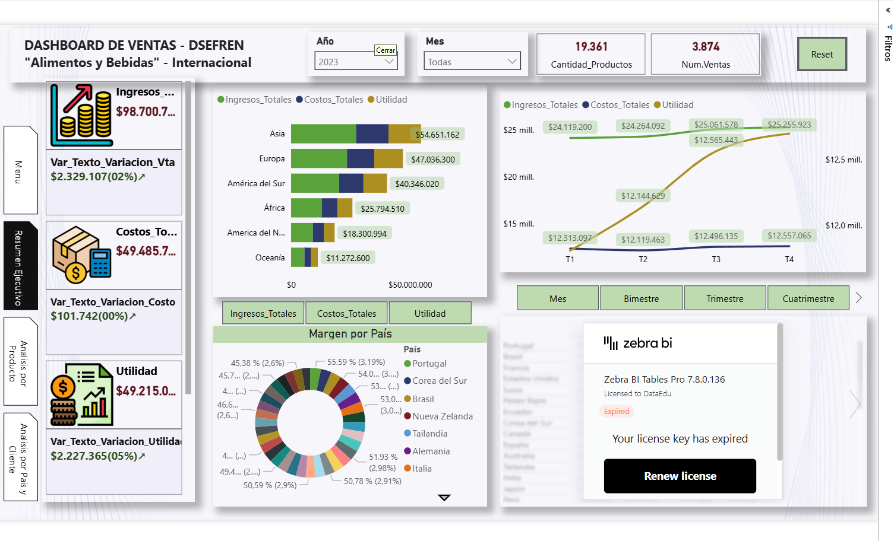
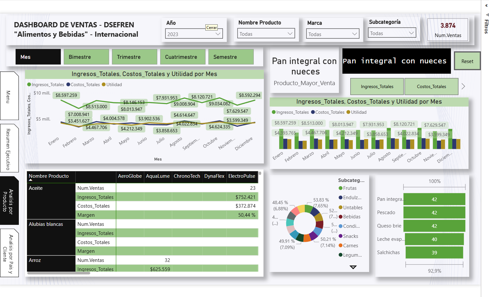
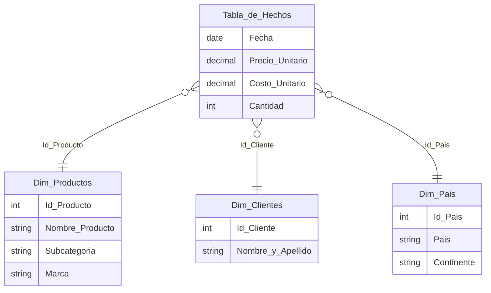

[← Volver al portafolio de Power BI](../README.md)

# Ventas internacionales de alimentos y bebidas · DSEFREN

**Empresa:** DSEFREN (caso de estudio con datos simulados) · **Periodo:** 2020 – 2023 · **Alcance:** 36 países en 6 continentes

**Pregunta de negocio:** ¿dónde se gana y dónde se pierde margen? ¿Qué productos, países y clientes sostienen los ingresos y cómo evolucionan año contra año?

  

## Cifras del caso

| Indicador | Valor |
|---|---|
| Transacciones analizadas | **15,553** |
| Ingresos totales 2020–2023 | **$390.3 M** |
| Costos totales 2020–2023 | **$196.0 M** |
| Margen bruto | **≈ 49.8 %** |
| Catálogo | 130 productos · 100 clientes · 36 países |

---

## Vista 1 · Resumen ejecutivo
Para la gerencia: los tres KPIs principales (ingresos, costos y utilidad) con su variación contra el año anterior, la tendencia trimestral y el margen por país.

- En 2023: ingresos de **$98.7 M**, costos de **$49.5 M** y utilidad de **$49.2 M**, con variaciones interanuales calculadas en DAX.
- Asia y Europa son los continentes con mayores ingresos del año.

## Vista 2 · Análisis por producto
Para el área comercial y de compras: qué productos, marcas y subcategorías generan valor.

- Ranking de productos (el más vendido: *Pan integral con nueces*).
- Matriz de rentabilidad por subcategoría y marca, con número de ventas, ingresos, costos y margen.
- Evolución mensual con cambio de granularidad: mes, bimestre, trimestre, cuatrimestre o semestre.

## Vista 3 · Análisis por país y cliente
Para expansión y gestión de cuentas: dónde están los mercados y los clientes más importantes.

- Asia es el continente con más transacciones (4,436) y Malasia el país con mayores ingresos.
- Top 5 de clientes por facturación y comparativo de ingresos, costos y utilidad en los 36 países.

---

## 🧩 Modelo de datos (esquema estrella)

Una tabla de hechos con 15,553 ventas y tres dimensiones. Ingresos, costos, utilidad, margen y variaciones interanuales se calculan como medidas DAX, no como columnas, para que respondan a cualquier filtro.

## ⚙️ Funcionalidades
- **Navegación por menú lateral** entre las tres vistas, con botón de reinicio de filtros.
- **Segmentadores** por año, mes, producto, marca, subcategoría, continente, país y cliente.
- **Tooltips personalizados** (4 páginas) para ver el detalle sin salir de la vista.
- **Zebra BI** para tablas y gráficos financieros con el estándar IBCS.

---

## 📂 Archivos

| Archivo | Contenido |
|---|---|
| [`ventas-dsefren.pbix`](ventas-dsefren.pbix) | Dashboard de Power BI Desktop |
| [`ventas-dsefren.xlsx`](ventas-dsefren.xlsx) | Tabla de hechos y dimensiones |
| [`capturas/`](capturas) | Imágenes de cada vista |

## ▶️ Cómo abrirlo

1. Descarga el repositorio (**Code → Download ZIP**).
2. Abre `ventas-dsefren.pbix` con **Power BI Desktop** (gratuito, Windows).
3. Si no encuentra los datos: **Transformar datos → Configuración de origen de datos → Cambiar origen** y selecciona `ventas-dsefren.xlsx`.

> Los visuales de Zebra BI requieren licencia; sin ella se muestran con marca de agua.

---

Efren Cherres Bowen · ECHB Consulting & Think Analytics · DSEFREN es una empresa ficticia con datos simulados.
