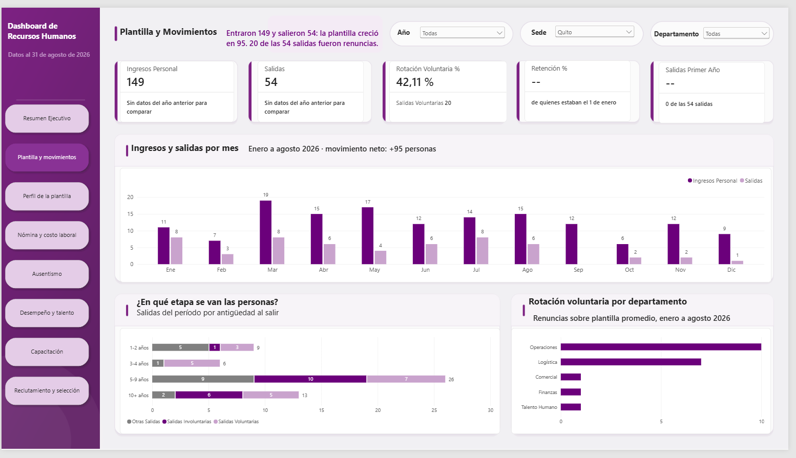
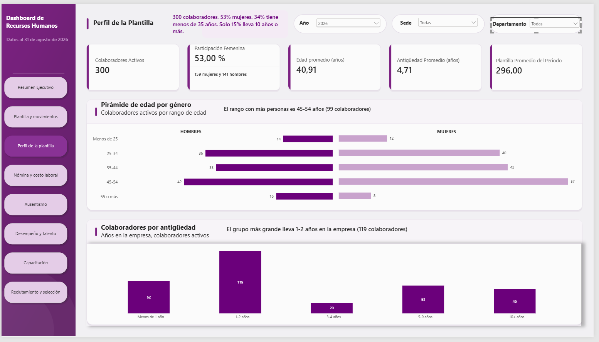
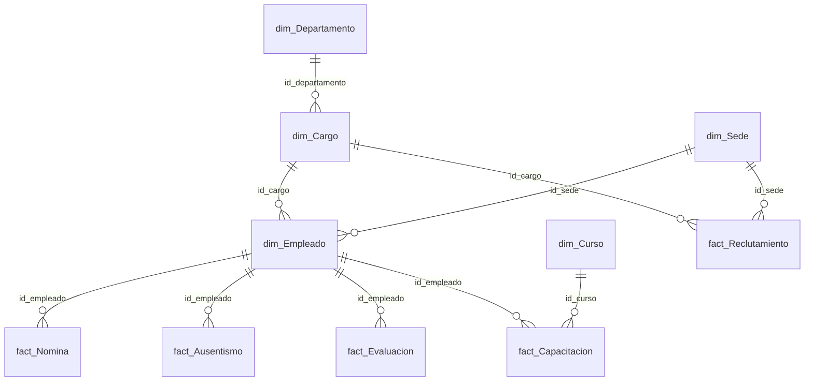

[← Volver al portafolio de Power BI](../README.md)

# Dashboard de Recursos Humanos

<p>
  
  
  
</p>

**Empresa:** ficticia, con sedes en Guayaquil, Quito, Cuenca, Manta y Machala · **Periodo:** enero 2024 – agosto 2026 · **Alcance:** 8 departamentos, 477 colaboradores históricos

**Pregunta de negocio:** ¿cuánta gente tenemos, cuánta se va y por qué, cuánto cuesta la plantilla y dónde hay que actuar primero?

Lo construyo página por página; este README se actualiza con cada avance.

---

## 🚦 Avance

| # | Página | Estado | Qué responde |
|:-:|---|:-:|---|
| 1 | [Resumen ejecutivo](#1--resumen-ejecutivo) | ✅ | Headcount, rotación, salidas, costo laboral y ausentismo de los últimos 12 meses, con variación contra el año anterior |
| 2 | [Plantilla y movimientos](#2--plantilla-y-movimientos) | ✅ | Ingresos vs. salidas por mes, retención, rotación voluntaria y en qué etapa se van las personas |
| 3 | [Perfil de la plantilla](#3--perfil-de-la-plantilla) | ✅ | Pirámide de edad por género, antigüedad y participación femenina |
| 4 | Nómina y costo laboral | 🚧 | Masa salarial y costo empresa por departamento y empleado (IESS, décimos, fondos de reserva) |
| 5 | Ausentismo | 🚧 | Tasa de ausentismo, horas perdidas y tipos de ausencia |
| 6 | Desempeño y talento | ⏳ | Evaluaciones y matriz desempeño-potencial |
| 7 | Capacitación | ⏳ | Horas, costo, asistencia y aprobación por curso |
| 8 | Reclutamiento y selección | ⏳ | Vacantes, tiempo de cobertura, fuentes y costo por contratación |

✅ completa · 🚧 en construcción · ⏳ pendiente

---

## 1 · Resumen ejecutivo
Para la gerencia: los cinco indicadores clave con su variación contra el mismo corte del año anterior, la evolución mensual de plantilla y rotación, los motivos de salida y una tabla que señala qué departamentos requieren atención. El título resume la página en una frase que se escribe sola con DAX según los filtros.


## 2 · Plantilla y movimientos
Cuántas personas entran y salen cada mes, qué parte de las salidas son renuncias y en qué etapa de antigüedad se van.



## 3 · Perfil de la plantilla
Composición de la plantilla activa: pirámide de edad por género, distribución por antigüedad y participación femenina.



---

## 🧩 Modelo de datos

Esquema estrella con **5 tablas de hechos** y **5 dimensiones** más un calendario:



| Tabla | Filas | Qué es una fila |
|---|--:|---|
| fact_Nomina | 9,546 | Rol de pago mensual de un colaborador |
| fact_Ausentismo | 2,739 | Una ausencia (días, tipo, horas perdidas) |
| fact_Capacitacion | 1,245 | Participación de un colaborador en un curso |
| fact_Evaluacion | 557 | Evaluación anual de desempeño |
| fact_Reclutamiento | 185 | Una vacante abierta |
| dim_Empleado | 477 | Un colaborador (activo o con fecha de salida) |

**Nómina ecuatoriana:** aportes al IESS personal (9.45 %) y patronal (11.15 %), décimo tercero, décimo cuarto y fondos de reserva desde el segundo año, con el salario básico unificado de cada año.

## 📐 Cómo se calculan los indicadores clave

**Rotación 12 meses:** salidas de los últimos 12 meses sobre la plantilla promedio entre el inicio y el cierre del periodo.

```DAX
Rotación 12M % =
VAR FechaCorte = MIN ( MAX ( Dim_Calendario[Date] ), [Fecha Último Dato] )
VAR Salidas12M =
    CALCULATE ( [Salidas], DATESINPERIOD ( Dim_Calendario[Date], FechaCorte, -12, MONTH ) )
VAR HCFin    = CALCULATE ( [Headcount], Dim_Calendario[Date] = FechaCorte )
VAR HCInicio = CALCULATE ( [Headcount], Dim_Calendario[Date] = EDATE ( FechaCorte, -12 ) )
RETURN
    DIVIDE ( Salidas12M, DIVIDE ( HCFin + HCInicio, 2 ) )
```

`FechaCorte` evita que el indicador se calcule sobre meses sin datos: toma el último día con información aunque el filtro llegue a diciembre.

**Insight automático:** el titular de cada página es una medida que redacta la conclusión según los filtros. Por ejemplo, indica si la rotación sube o baja, en cuántos puntos y qué departamento tiene la tasa más alta.

**Otros indicadores:** tasa de ausentismo (horas perdidas sobre horas programadas), retención, salidas en el primer año, costo laboral 12M y sus variaciones interanuales, todos como medidas DAX.

---

## 📂 Archivos

| Archivo | Contenido |
|---|---|
| [`dashboard-rrhh.pbix`](dashboard-rrhh.pbix) | Dashboard de Power BI Desktop (versión en curso) |
| [`BD_RRHH_PowerBI.xlsx`](BD_RRHH_PowerBI.xlsx) | Base de datos: 11 tablas y hoja LEEME con supuestos |
| [`capturas/`](capturas) | Imágenes de cada página terminada |

## ▶️ Cómo abrirlo

1. Descarga el repositorio (**Code → Download ZIP**).
2. Abre `dashboard-rrhh.pbix` con **Power BI Desktop**.
3. Para actualizar los datos: **Transformar datos → Configuración de origen de datos → Cambiar origen** y selecciona `BD_RRHH_PowerBI.xlsx`.

---

<sub>Efren Cherres Bowen · ECHB Consulting & Think Analytics · Todos los nombres, cédulas y montos son ficticios y generados aleatoriamente.</sub>
