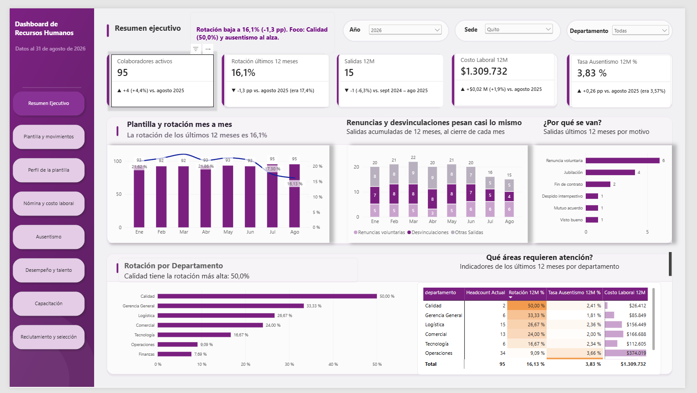

<p align="center">
  
  
  
  
  
</p>

Dashboards de Business Intelligence construidos de punta a punta: modelo de datos, medidas DAX y diseño de reportes pensados para que cada nivel de la organización encuentre la respuesta que necesita en pocos clics.

> Un buen dashboard no muestra todos los datos: muestra **los indicadores que sirven para decidir**.

---

## 📊 Proyectos

<table>
<tr>
<td width="50%" valign="top">

### [02 · Recursos Humanos](02-rrhh/)
<a href="02-rrhh/"></a>

Plantilla, rotación, ausentismo y costo laboral de una empresa con 5 sedes en Ecuador. 5 tablas de hechos, nómina ecuatoriana completa y 90 medidas DAX con insights automáticos.

🚧 **En construcción** · 3 de 8 páginas completas
**[Ver proyecto →](02-rrhh/)**

</td>
<td width="50%" valign="top">

### [01 · Ventas internacionales](01-ventas-dsefren/)
<a href="01-ventas-dsefren/"></a>

Alimentos y bebidas en 36 países, 2020–2023: $390 M en ingresos analizados por producto, país y cliente, con variaciones interanuales en DAX.

✅ **Terminado** · 3 vistas
**[Ver proyecto →](01-ventas-dsefren/)**

</td>
</tr>
</table>

---

## 🛠️ Lo que se ve en estos proyectos

- **Modelado:** esquemas estrella, tablas de hechos y dimensiones, calendario propio y relaciones inactivas con `USERELATIONSHIP`.
- **DAX:** inteligencia de tiempo (12 meses móviles, año contra año), KPIs con variación y color dinámico, títulos e insights que se redactan solos.
- **Power Query:** importación y limpieza desde Excel.
- **Diseño:** navegación por menú, segmentadores sincronizados y páginas pensadas para una pregunta de negocio cada una.

## 🗂️ Estructura

```
portafolio-power-bi/
├── 01-ventas-dsefren/   # .pbix, datos, capturas y README del proyecto
├── 02-rrhh/             # .pbix, datos, capturas y README del proyecto
└── assets/              # banner
```

Cada proyecto se abre con **Power BI Desktop** (gratuito, Windows); las instrucciones están en su propio README.

---

<p align="center">
  <b>Efren Cherres Bowen</b> · ECHB Consulting & Think Analytics<br>
  <i>Calidad que se mide. Datos que mejoran.</i><br><br>
  <a href="https://github.com/EfrenCherres">GitHub</a> ·
  <a href="https://www.linkedin.com/in/efren-cherres-06a60271">LinkedIn</a> ·
  <a href="https://orcid.org/0009-0006-1687-1187">ORCID</a>
</p>
