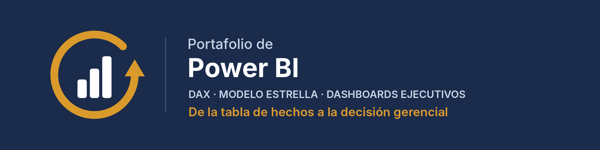
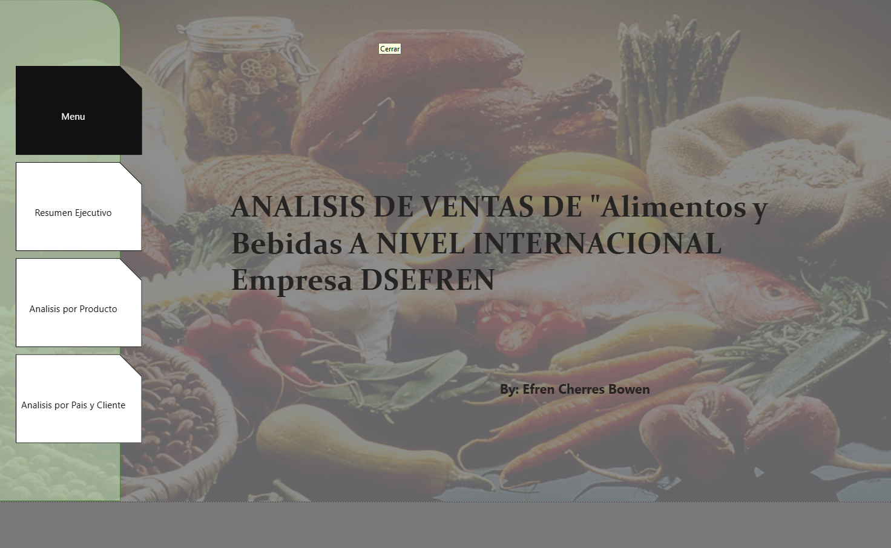
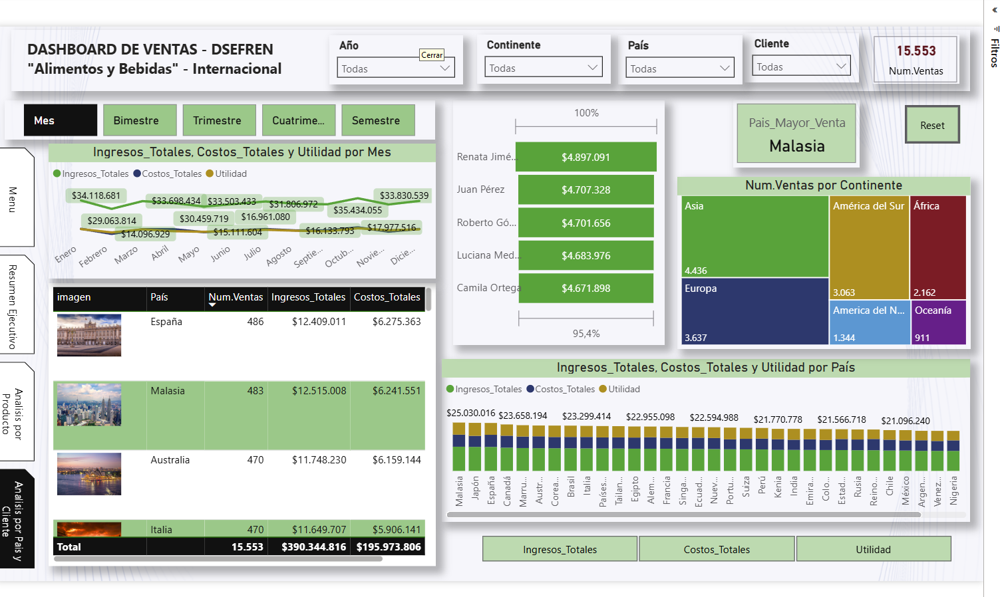
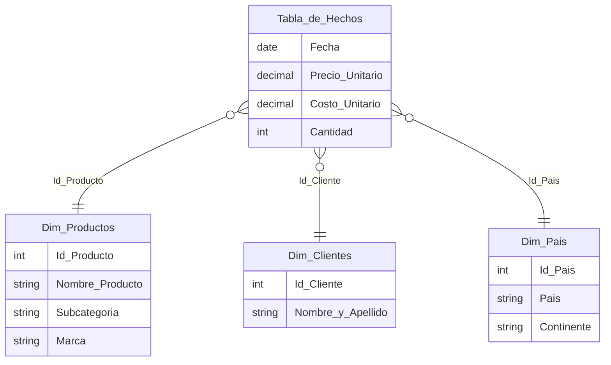

<p align="center">
  
  
  
  
  
</p>

Dashboards de Business Intelligence construidos de punta a punta: modelo de datos, medidas DAX y diseño de reportes pensados para que cada nivel de la organización encuentre la respuesta que necesita en pocos clics.

> Un buen dashboard no muestra todos los datos: muestra **los indicadores que sirven para decidir**.

---

## 📊 Proyecto 01 · Ventas internacionales de alimentos y bebidas

**Empresa:** DSEFREN (caso de estudio con datos simulados) · **Periodo:** 2020 – 2023 · **Alcance:** 36 países en 6 continentes

**Pregunta de negocio:** ¿dónde se gana y dónde se pierde margen? ¿Qué productos, países y clientes sostienen los ingresos y cómo evolucionan año contra año?

<p align="center">
  
</p>

### Cifras del caso

| Indicador | Valor |
|---|---|
| Transacciones analizadas | **15,553** |
| Ingresos totales 2020–2023 | **$390.3 M** |
| Costos totales 2020–2023 | **$196.0 M** |
| Margen bruto | **≈ 49.8 %** |
| Catálogo | 130 productos · 100 clientes · 36 países |

---

### Vista 1 · Resumen ejecutivo
Para la gerencia: los tres KPIs principales (ingresos, costos y utilidad) con su variación contra el año anterior, la tendencia trimestral y el margen por país.


- En 2023: ingresos de **$98.7 M**, costos de **$49.5 M** y utilidad de **$49.2 M**, con variaciones interanuales calculadas en DAX.
- Asia y Europa son los continentes con mayores ingresos del año.

### Vista 2 · Análisis por producto
Para el área comercial y de compras: qué productos, marcas y subcategorías generan valor.


- Ranking de productos (el más vendido: *Pan integral con nueces*).
- Matriz de rentabilidad por subcategoría y marca, con número de ventas, ingresos, costos y margen.
- Evolución mensual con cambio de granularidad: mes, bimestre, trimestre, cuatrimestre o semestre.

### Vista 3 · Análisis por país y cliente
Para expansión y gestión de cuentas: dónde están los mercados y los clientes más importantes.



- Asia es el continente con más transacciones (4,436) y Malasia el país con mayores ingresos.
- Top 5 de clientes por facturación y comparativo de ingresos, costos y utilidad en los 36 países.

---

### 🧩 Modelo de datos (esquema estrella)



Una tabla de hechos con 15,553 ventas y tres dimensiones. Ingresos, costos, utilidad, margen y variaciones interanuales se calculan como medidas DAX, no como columnas, para que respondan a cualquier filtro.

### ⚙️ Funcionalidades
- **Navegación por menú lateral** entre las tres vistas, con botón de reinicio de filtros.
- **Segmentadores** por año, mes, producto, marca, subcategoría, continente, país y cliente.
- **Tooltips personalizados** (4 páginas) para ver el detalle sin salir de la vista.
- **Zebra BI** para tablas y gráficos financieros con el estándar IBCS.

---

## 🗂️ Estructura

```
portafolio-power-bi/
├── dashboard/
│   └── ventas-dsefren.pbix      # archivo de Power BI Desktop
├── data/
│   └── ventas-dsefren.xlsx      # tabla de hechos + dimensiones
├── assets/                      # banner y capturas del dashboard
└── LICENSE
```

## ▶️ Cómo abrirlo

1. Descarga el repositorio (**Code → Download ZIP**) o clónalo.
2. Abre `dashboard/ventas-dsefren.pbix` con **Power BI Desktop** (gratuito, Windows).
3. Si Power BI no encuentra los datos, ve a **Transformar datos → Configuración de origen de datos** y apunta a `data/ventas-dsefren.xlsx`.

> Los visuales de Zebra BI requieren licencia; sin ella, esos gráficos se muestran con una marca de agua.

---

<p align="center">
  <b>Efren Cherres Bowen</b> · ECHB Consulting & Think Analytics<br>
  <i>Calidad que se mide. Datos que mejoran.</i><br><br>
  <a href="https://github.com/EfrenCherres">GitHub</a> ·
  <a href="https://www.linkedin.com/in/efren-cherres-06a60271">LinkedIn</a> ·
  <a href="https://orcid.org/0009-0006-1687-1187">ORCID</a>
</p>
